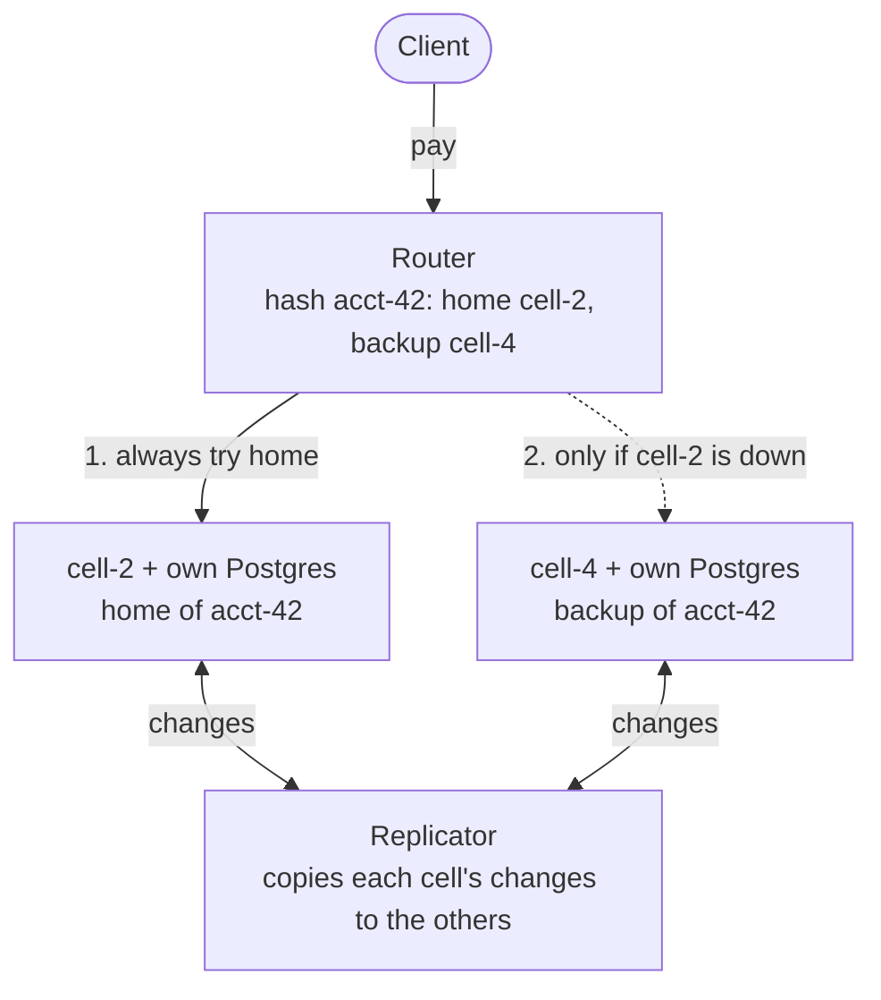
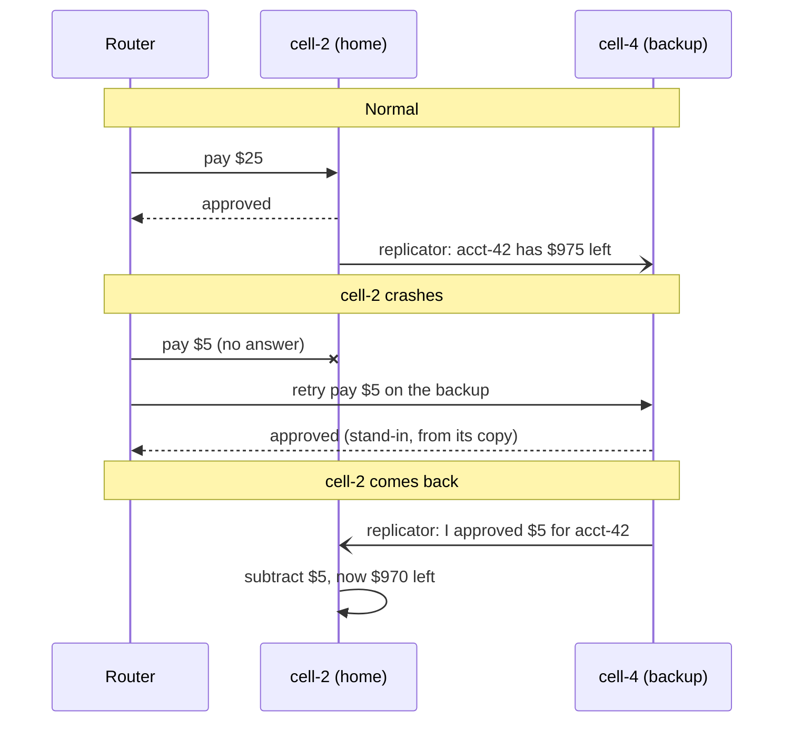
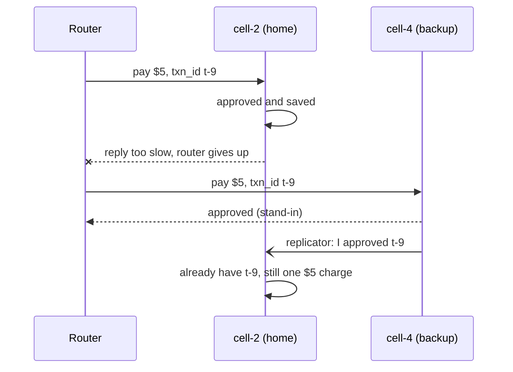

# cellular-auth

[](https://github.com/ksamirdev/cellular-auth/actions/workflows/ci.yml)

A small card payment system in Go that keeps approving payments even when part of it crashes.

I built it to learn how real payment systems stay up.
It applies the cell pattern from American Express's blog post on [cell-based architecture](https://americanexpress.io/cell-based-architecture-for-resilient-payment-systems/) to the card issuer's side.
Amex's cells forward payments to issuers; this system is the issuer that approves or declines them.

## The problem, with an example

Alice taps her card to buy a coffee.
Her account `acct-42` is stored on one server, **cell-2**.
At that moment, cell-2 crashes.

In a simple system, Alice's card is declined, even though she has money.
Worse, if everyone's accounts are on that one server, *every* card is declined.

This project fixes both problems:

1. **Split accounts across many small servers (cells).** If cell-2 crashes, only cell-2's accounts are affected. Everyone else is fine.
2. **Give every account a backup cell.** `acct-42` lives on cell-2 (its **home**) and has a copy on cell-4 (its **backup**). While cell-2 is down, cell-4 approves Alice's coffee using its copy. This is called **stand-in**.
3. **Sync up afterwards.** When cell-2 comes back, cell-4 tells it about the coffee. Alice is charged exactly once.

## Quick start

You need Go 1.26, Docker, and [just](https://github.com/casey/just).

```sh
just up      # start 4 cells, 4 Postgres databases, the router and the replicator
just chaos   # send 1000 payments/sec for 60s, kill cell-2 at 20s, bring it back at 40s
just down
```

Or try a payment by hand:

```sh
curl -X POST localhost:8080/v1/accounts \
  -d '{"account_id":"acct-42","credit_limit_minor":100000}'

curl -X POST localhost:8080/v1/authorizations \
  -d '{"txn_id":"t-1","account_id":"acct-42","amount_minor":2500}'
# {"txn_id":"t-1","decision":"approved","mode":"home","cell":"cell-2"}

docker kill cellular-auth-cell-2-1   # crash acct-42's home cell

curl -X POST localhost:8080/v1/authorizations \
  -d '{"txn_id":"t-2","account_id":"acct-42","amount_minor":2500}'
# {"txn_id":"t-2","decision":"approved","mode":"standin","cell":"cell-4"}
```

Amounts are in **minor units**, which means cents.
So `100000` is a $1,000 credit limit and `2500` is a $25 payment.

## How it works

### The big picture



There are four cells in total.
Each cell is a home for some accounts and a backup for others.
The diagram only shows the two that matter for `acct-42`.

### What happens when a cell crashes



### The main pieces

**Router - "where does this account live?"**
Every payment goes through the router.
It hashes the account id to rank the cells, using [rendezvous hashing](https://en.wikipedia.org/wiki/Rendezvous_hashing).
First place is the home cell, second place is the backup.
No lookup table is needed, so every router instance gets the same answer.

**Cell - "can this account pay?"**
The home cell locks the account row, checks the balance, and saves the decision, all inside one database transaction.
That way two payments at the same time can't both spend the same dollar.

**Idempotency - "don't charge twice"**
Every payment has a `txn_id`.
If the client retries with the same `txn_id`, the cell returns the saved answer instead of charging again.

**Stand-in limit - "how much can the backup risk?"**
The backup's copy can be a fraction of a second out of date.
So the backup only approves while the account's not-yet-synced stand-in approvals stay under a cap, $500 by default (`STANDIN_CAP_MINOR=50000`).
This puts a limit on how much an account can overspend while its home cell is down.
Some card networks offer a version of this, called stand-in processing, that approves on the issuer's behalf when the issuer is down.

**Replicator - "keep the cells in sync"**
When a cell changes something, it also writes an event to an **outbox** table in the same transaction.
The replicator copies each cell's outbox to the other cells.
Backups use these events to keep their copies fresh, and home cells use them to learn about stand-in approvals they missed.
Each cell remembers how far it has read, so if the replicator crashes it carries on where it stopped.

### The tricky case

If the home cell is slow and the router gives up waiting, the router can't tell whether the home approved the payment.
It sends the payment to the backup anyway, so the same payment might be approved twice.



Because both cells use the same `txn_id`, the sync merges them into **one** charge.
If the home had declined but the backup approved, the merchant has already been told "approved", so the home accepts the approval.

### The tradeoff I chose

When a cell is down, a system can either refuse payments (always correct, but customers are stuck) or approve them from a copy (always available, but the copy might be a little stale).
This is the classic consistency vs availability tradeoff from the [CAP theorem](https://en.wikipedia.org/wiki/CAP_theorem).
I chose availability, and used the stand-in limit to cap how wrong it can be.

## Results

60,000 payments in 60 seconds, with cell-2 killed for 20 of them:

- **No payment failed.** 99.99% were approved, and the rest were declined on purpose by the stand-in limit.
- **cell-2's customers never saw an error.** Their backup cells took over in about 0.1 seconds.
- **Other customers noticed nothing.** None of their payments went through stand-in.
- **The money adds up.** An audit of every database found 0 double charges and 0 lost payments.

<details>
<summary>Full numbers</summary>

Four cells with four Postgres databases on one laptop (Apple M3 Pro, Docker on OrbStack), 2000 accounts.

| | cell process killed | cell database killed |
| --- | --- | --- |
| Payments | 60,000 | 60,000 |
| Approved | 99.99% | 99.97% |
| Failed or unavailable | 0 | 0 |
| First stand-in approval after the kill | 103 ms | 41 ms |
| Other cells' payments served by stand-in | 0% | 0% |
| Latency p50 / p99, home cell | 1.6 / 53 ms | 1.7 / 56 ms |
| Latency p50 / p99, stand-in | 1.7 / 126 ms | 1.8 / 66 ms |
| Retries with the same `txn_id` that changed decision | 0 of 3,026 | 0 of 3,027 |
| Ledger mismatches, lost or unsynced stand-ins | 0 | 0 |

p50 means half the payments were faster than this.
p99 means 99% were faster.
The declines were 5 and 17 payments that hit the stand-in limit.
Run `just chaos pg-2` to kill the database instead of the process.

</details>

## Bugs I found by breaking it

All of these passed the unit tests.
They only showed up when I ran real load and killed a cell.

### 1. The health check killed healthy cells

When cell-2 died, its traffic moved to the backups and they got busy.
Their `/healthz` check pinged the database using the same connection pool as real payments, so the ping waited in line and timed out.
The router thought those busy cells were dead and stopped sending them traffic.
About 0.75% of payments failed for accounts that had nothing to do with cell-2.

**Fix:** health checks now use their own single database connection.

**Lesson:** a health check should answer "are you alive?", not "are you busy?".
The [AWS article on health checks](https://aws.amazon.com/builders-library/implementing-health-checks/) describes this exact problem.

### 2. Postgres sorted numbers as text

2,207 stand-in approvals never reached their home cell.
Every lost one had a transaction id below 10000.
My query selected `txid::text` and then sorted by `txid`, and Postgres [sorted by the text column](https://www.postgresql.org/docs/current/queries-order.html), not the number.
As text, `"10000"` comes before `"6900"`, so the reader skipped about three thousand events.

**Fix:** sort by the numeric value. [`TestOutboxOrdersTxidsNumerically`](internal/cell/store_test.go) fails on the old query.

**Lesson:** when data goes missing, look for a pattern in *which* data is missing.

### 3. An auto-increment id is not a safe "read up to here" marker

Transaction A takes outbox id 10, transaction B takes id 11, and B commits first.
A reader sees 11, remembers "I've read up to 11", and never sees 10 when it finally commits.

**Fix:** order by the transaction id (`xid8`) and only read rows older than every transaction still running ([`pg_snapshot_xmin`](https://www.postgresql.org/docs/current/functions-info.html)).

**Lesson:** "assigned in order" and "committed in order" are not the same thing.

### 4. My benchmark was wrong too

Through Docker's port forwarding on my Mac, the slowest payments took over a second.
From inside the Docker network it was 48 ms, so the load generator now runs there.
Go's `time.Ticker` also quietly skipped ticks and sent 447 payments/sec when I asked for 500.

**Fix:** the load generator follows a fixed schedule and reports the rate it really achieved.

**Lesson:** when a number looks strange, check the measuring tool before the system.

## What I learned

- **Failures spread in surprising ways.** One dead cell broke other cells through the health check, not through the database.
- **Unit tests are not enough for distributed systems.** Every bug above needed real load plus a real crash to appear.
- **Idempotency keys make retries safe.** Once every payment has a `txn_id`, rerouting and retrying stop being scary.
- **Writing the event in the same transaction as the change** (the outbox pattern) means the two can never disagree.
- **Databases have subtle rules.** I learned how Postgres row locks, transaction ids and `ORDER BY` really behave.

I wrote my design decisions down as [ADRs](docs/adr) (short notes on what I decided and why).

## How I built this

I built this with [Claude Code](https://claude.com/claude-code) as a pair programmer.
It wrote most of the code and the tests, and ran the chaos experiments.
I decided what to build, asked questions until I understood each piece, and didn't accept a result until the numbers held up.

Rules I followed:

- Reproduce every bug under real load before changing any code.
- Fix the real cause, not the symptom. For example, the health-check bug was not fixed by making timeouts longer.
- Add a test that fails without each fix, and run the full suite with `-race` several times.

## What's missing and what I'd try next

- **Lost replies.** If the home cell approves but its reply is lost, the money is held but the merchant never knew. A real bank reverses this, and this project doesn't yet.
- **Slow cells.** A cell that is slow but alive still sends traffic to stand-in, which uses up stand-in limit for no reason.
- **Gradual traffic shifting.** Draining a cell is all or nothing. The Amex post shifts traffic by percentage.
- **Adding cells.** Changing the number of cells moves some accounts to new homes, and there is no migration for them.

## Project layout

| Package | What it does |
| --- | --- |
| [`internal/cell`](internal/cell) | Balances, stand-in rules, outbox and applying synced events |
| [`internal/router`](internal/router) | Picks cells, health checks, failover, drain |
| [`internal/replication`](internal/replication) | Copies outbox events between cells |
| [`internal/audit`](internal/audit) | Checks every database to prove no money was lost or doubled |
| [`internal/e2e`](internal/e2e) | Runs real cells, router and replicator in one test and kills a cell mid-test |
| [`cmd/chaos`](cmd/chaos) | Load generator, cell killer and report |

Built with [pgx](https://github.com/jackc/pgx) for Postgres, [goose](https://github.com/pressly/goose) for migrations, [uber-go/fx](https://uber-go.github.io/fx/) to wire services together, and Prometheus for metrics.

Run all tests with `just test` (starts a throwaway Postgres in Docker).

<details>
<summary>What I read</summary>

- [Cell-Based Architecture for Resilient Payment Systems](https://americanexpress.io/cell-based-architecture-for-resilient-payment-systems/), American Express. The design this project is based on.
- [Reducing the Scope of Impact with Cell-Based Architecture](https://docs.aws.amazon.com/wellarchitected/latest/reducing-scope-of-impact-with-cell-based-architecture/reducing-scope-of-impact-with-cell-based-architecture.html), AWS. How to route and size cells.
- [Workload isolation using shuffle-sharding](https://aws.amazon.com/builders-library/workload-isolation-using-shuffle-sharding/), AWS. Why account placement decides how many customers a failure hits.
- [Implementing health checks](https://aws.amazon.com/builders-library/implementing-health-checks/), AWS. The cause of bug 1.
- [Rendezvous hashing](https://en.wikipedia.org/wiki/Rendezvous_hashing). Picking a home cell without a lookup table.
- [splitmix64](https://prng.di.unimi.it/splitmix64.c), Sebastiano Vigna. Fixes FNV hashing clumping similar account ids together.
- [Designing robust and predictable APIs with idempotency](https://stripe.com/blog/idempotency), Stripe, and [Implementing Stripe-like Idempotency Keys in Postgres](https://brandur.org/idempotency-keys), Brandur Leach.
- [Transactional outbox](https://microservices.io/patterns/data/transactional-outbox.html), microservices.io.
- PostgreSQL docs on [transaction ids](https://www.postgresql.org/docs/current/functions-info.html), [sorting](https://www.postgresql.org/docs/current/queries-order.html) and [row locks](https://www.postgresql.org/docs/current/explicit-locking.html).

</details>

## License

[MIT](LICENSE)
